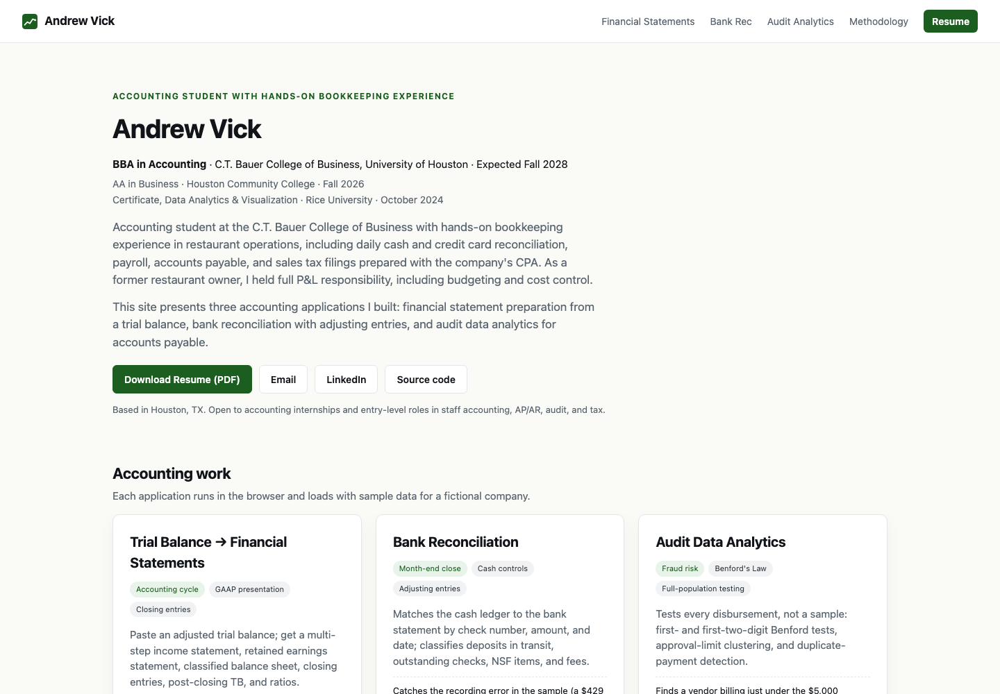
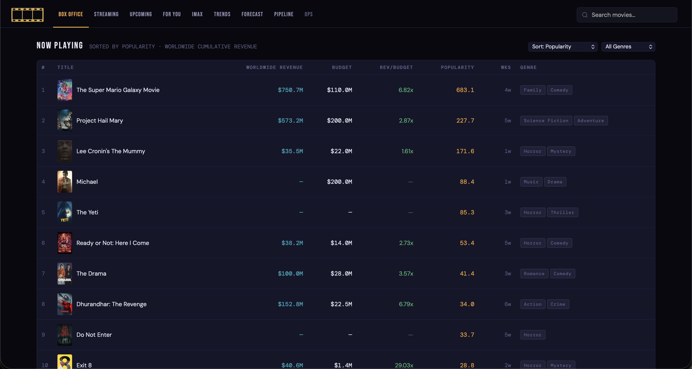

# Andrew Vick — Accounting Student & Data Analyst

📧 andrew.vick@outlook.com &nbsp;|&nbsp; 📍 Houston, TX &nbsp;|&nbsp; [LinkedIn](https://www.linkedin.com/in/andrew-m-vick) &nbsp;|&nbsp; [Resume](https://github.com/andrew-m-vick/portfolio/blob/main/resume.pdf) &nbsp;|&nbsp; [CV](https://github.com/andrew-m-vick/portfolio/blob/main/cv.pdf)

---

## About Me

Hi, I'm Andrew — an accounting student and data analyst based in Houston, TX, pursuing a BBA in Accounting at the C.T. Bauer College of Business, University of Houston.

I came to accounting from the operator's side of the ledger. A decade in restaurants — managing Morningside Thai, and before that owning Zabs Asian Bistro with full P&L responsibility — means the close cycle isn't theory to me. Reconciliations, payroll, accounts payable, and sales tax filings with the company's CPA are work I've done every month for years, not coursework I've sat through.

What I add on top of that is tooling. I build the workpapers most people keep in spreadsheets: my [Accounting Portfolio](https://web-production-a0dcb.up.railway.app) converts a trial balance into financial statements, closing entries, and ratios (and diagnoses what's throwing the balance off), reconciles a cash ledger to the bank statement with classified reconciling items and drafted adjusting entries, and tests AP disbursements with Benford's Law, approval-limit clustering, and duplicate-payment checks. As a data analyst at Indigena Capital, I clean and reconcile multi-season operational records into reliable reporting datasets and build the Tableau dashboards stakeholders plan against.

I hold a certificate in Data Analytics & Visualization from Rice University and complete an AA in Business at Houston Community College in Fall 2026.

**Targeting roles in:** accounting / staff accountant · audit & assurance · accounting & financial data analytics

---

## Technical Skills

- **Accounting:** Financial statement preparation from trial balance, closing entries, bank and cash reconciliation, payroll and tip reporting, accounts payable, sales tax filings, P&L and budgeting, audit data analytics (Benford's Law, duplicate-payment and approval-limit testing)
- **Languages & Core Tools:** Python, SQL, JavaScript, HTML, CSS, VBA, Microsoft Excel
- **Frameworks & Libraries:** Flask (app factory + blueprints), SQLAlchemy, Flask-Login, Jinja, Pandas, NumPy, Scikit-Learn, Chart.js, Leaflet.js, AG Grid
- **Databases:** PostgreSQL (Neon, pgAdmin), MySQL, SQLite
- **Visualization:** Tableau (incl. JWT Connected App embed), Power BI, Chart.js, Matplotlib, Leaflet
- **ML & Analytics:** Scikit-Learn (regression, RandomForest), joblib model persistence, Groq and Claude (Anthropic) LLM APIs
- **DevOps & Tools:** Git, GitHub Actions, Railway, Gunicorn, SendGrid, pytest, PWAs (service workers + manifests), Jupyter, VS Code

---

## Projects

### 🧾 [Accounting Portfolio — Trial Balance, Bank Rec & Audit Analytics](https://web-production-a0dcb.up.railway.app)
Three browser-based accounting applications, each loading with sample data for a fictional company.

**Trial Balance → Financial Statements** — paste an adjusted trial balance and get a multi-step income statement, retained earnings statement, classified balance sheet, closing entries, a post-closing trial balance, and ratios. When the trial balance doesn't balance, it diagnoses *why*: transpositions (difference divisible by 9), wrong-side postings, omitted accounts.

**Bank Reconciliation** — matches the cash ledger to the bank statement by check number, amount, and date, then classifies deposits in transit, outstanding checks, NSF items, and bank fees and drafts the correcting journal entries. In the sample data it catches a $429 check booked as $492.

**Audit Data Analytics** — tests the full population of disbursements rather than a sample: first-digit and first-two-digit Benford's Law tests, approval-limit clustering, and duplicate-payment detection. Across 2,254 AP payments it flags a vendor billing just under the $5,000 approval limit and writes up the follow-up audit procedures.

**Tools:** Python, Flask, Pandas, NumPy, JavaScript, Chart.js, HTML, CSS, Railway, Gunicorn

---

### 🎬 [CINEDATA — Movie Box Office Analytics Platform](https://andrew-vick-movies.up.railway.app)
A cinephile's dashboard for tracking what's in theaters, what's streaming, and what's coming — with a focus on premium formats and the curation a repertory programmer would actually give. Built a full-stack movie analytics platform that aggregates data from TMDB, OMDb, and Watchmode APIs to surface box office trends, upcoming release pipeline, and streaming availability. Architected end-to-end with a Medallion Architecture data pipeline, interactive Chart.js dashboards, an in-browser forecast model, and a Groq-powered Llama 3.3 AI recommender that goes global, era-diverse, and beyond obvious picks. **IMAX deep-dive:** an auto-updated Now Playing feed (GitHub Actions scrapes Wikipedia weekly), a manually curated registry of films *actually filmed* in IMAX (15/70mm vs. laser digital, no DMR upconverts), and a Leaflet-powered premium IMAX theater finder with auto-routing to the nearest 70mm or laser venue. Installable as a PWA on iOS / Android / desktop.

**Tools:** Python, Flask, Scikit-Learn, TMDB API, OMDb API, Watchmode API, Groq (Llama 3.3), Chart.js, Leaflet.js, GitHub Actions, JavaScript, HTML, CSS, Railway, Gunicorn

---

## Experience

### Morningside Thai Restaurant — Manager
Houston, TX · 2015 – 2017, 2020 – Present

- Reconcile daily cash and credit card sales, prepare bank deposits, and close out the POS system.
- Process payroll and tip reporting; review vendor invoices and process payments.
- Prepare sales tax filings with the restaurant's CPA and manage labor costs against budget targets.
- Oversee daily operations, including staffing, scheduling, inventory, and customer experience.

### Zabs Asian Bistro — Owner
Houston, TX · 2018 – 2020

- Launched and operated a full-service restaurant with full P&L responsibility, including budgeting and food and labor cost targets.
- Handled core bookkeeping (cash reconciliation, payroll, accounts payable) and sales tax filings in coordination with a CPA.

### Indigena Capital — Data Analyst
Houston, TX · 2024 – Present

- Cleaned and reconciled six seasons (2019–2025) of harvest records across multiple crops and sites into a reliable reporting dataset.
- Built yield forecasts and interactive Tableau dashboards that stakeholders use for production planning.
- Current work with the **Blood Tribe / Kainai Nation** is **Kainai Forage**, a role-gated platform built on that dataset: a scikit-learn yield-prediction model with weather scenarios, confidence ranges, and top-driver explanations, plus per-farmer dashboards and admin tooling for data upload and model retraining.

---

*Each project above links to a live production deployment. Source code for all Railway-deployed projects is available on [my GitHub](https://github.com/andrew-m-vick).*
