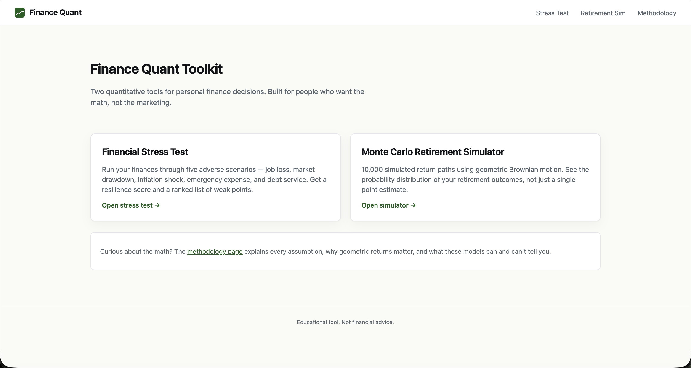

# Andrew Vick — Data Analyst & Full-Stack Builder

📧 andrew.vick@me.com &nbsp;|&nbsp; 📍 Houston, TX &nbsp;|&nbsp; [LinkedIn](https://www.linkedin.com/in/andrew-m-vick) &nbsp;|&nbsp; [Resume](https://github.com/andrew-m-vick/portfolio/blob/main/resume.pdf) &nbsp;|&nbsp; [CV](https://github.com/andrew-m-vick/portfolio/blob/main/cv.pdf)

---

## About Me

Hi, I'm Andrew — a data analyst and full-stack builder based in Houston, TX. I work across the complete analytics and engineering stack: Python, Flask, PostgreSQL, Apache Airflow, Tableau, and machine learning — and I ship what I build. Every project in this portfolio is deployed to production on Railway and is a click away.

What I care about is the handoff between analysis and decision. I've architected medallion-style ETL warehouses (Bronze → Silver → Gold), served scikit-learn models via joblib, embedded JWT-authenticated Tableau dashboards, and built quantitative tooling — Monte Carlo simulation with GBM drift correction, Kelly / EV sizing, scenario-weighted stress testing. Before data, I ran my own business for a decade, so I approach every analytical question with a P&L lens.

Currently pursuing a BBA in Finance at the University of Houston-Downtown to further strengthen quantitative and financial analysis capabilities. I hold a certificate in Data Analytics & Visualization from Rice University.

**Targeting roles in:** full-stack / Flask web development · analytics / data engineering · finance & quantitative analysis

---

## Technical Skills

- **Languages:** Python, SQL, JavaScript, TypeScript, HTML, CSS, VBA
- **Frameworks & Libraries:** Flask (app factory + blueprints), SQLAlchemy, Flask-Login, Flask-Migrate (Alembic), Jinja, Next.js, Bootstrap, Pandas, NumPy, Scikit-Learn, PySpark, Chart.js, Leaflet.js, KaTeX
- **Databases:** PostgreSQL (Neon, pgAdmin), MySQL, SQLite, MongoDB
- **Data Engineering:** Apache Airflow, Medallion Architecture (Bronze / Silver / Gold), ETL pipelines, REST API integration, rapidfuzz fuzzy matching, Socrata APIs
- **Visualization:** Tableau (JWT embed), Power BI, Matplotlib, Plotly, Chart.js, Leaflet
- **ML / AI:** Scikit-Learn (regression, prediction), joblib model persistence, Monte Carlo simulation, Claude (Anthropic) and Groq LLM APIs
- **DevOps & Tools:** Git, GitHub Actions, Docker Compose, Railway, Gunicorn, SendGrid, pytest, PWAs (service workers + manifests), AWS, Databricks, Jupyter, VS Code

---

## Projects

### 🎬 [CINEDATA — Movie Box Office Analytics Platform](https://andrew-vick-movies.up.railway.app)
Box office data is publicly available but rarely presented in a way that's analytical and intuitive at the same time. Built a full-stack movie analytics web platform that aggregates data from TMDB, OMDb, and Watchmode APIs to surface box office trends, rankings, release pipeline insights, and streaming availability. Architected and developed the entire platform end-to-end — multi-API data integration, a Medallion Architecture data pipeline, interactive Chart.js dashboards with Leaflet.js maps, an in-browser ridge regression forecast model, and a Groq-powered Llama 3.3 AI recommender. A Pipeline tab exposes the Medallion thinking (Bronze → Silver → Gold) for hiring-manager review.

**Tools:** Python, Flask, Scikit-Learn, TMDB API, OMDb API, Watchmode API, Groq (Llama 3.3), Chart.js, Leaflet.js, JavaScript, HTML, CSS, Railway, Gunicorn

---

### 📊 [Sports Betting Analytics Platform](https://web-production-daac0.up.railway.app)
Retail bettors lack a single place to see EV, Kelly sizing, arbitrage, and line movement across books. Built a full-stack betting analytics platform covering 7 US sports with live odds ingestion from The Odds API, quantitative tooling (expected value, Kelly sizing, Monte Carlo simulation, arbitrage detection), and a PostgreSQL-backed user system with bankroll tracking and bet history. Deployed as a PWA on Railway so it installs to a phone home screen.

**Tools:** Python, Flask, SQLAlchemy, Flask-Login, PostgreSQL (Neon), The Odds API, JavaScript, Chart.js, Service Workers, Railway

---

### 💹 [Finance Quant Toolkit](https://web-production-a0dcb.up.railway.app)
Retirement calculators either ignore volatility entirely or bury it behind a black-box slider. Built a finance tooling suite with two first-class calculators: a scenario-weighted stress test (bull / base / bear with custom probabilities) and a Monte Carlo retirement simulator running geometric Brownian motion with proper drift correction (m = ln(1+μ) − σ²/2). Outputs include depletion-age percentiles, success probability, and KaTeX-rendered math so the assumptions are auditable.

**Tools:** Python, Flask, NumPy, SciPy, Chart.js, KaTeX, JavaScript, HTML, CSS, Railway

---

### 🍽️ [Austin Restaurant Industry Analytics](https://texas-restaurants-production.up.railway.app)
The city of Austin publishes restaurant inspection and permit data separately, and nobody had joined them at the establishment level. Built an end-to-end analytics platform with a full Medallion Architecture ETL (Bronze → Silver → Gold) that ingests Socrata APIs, reconciles 1,177 establishments across datasets using rapidfuzz fuzzy matching with ZIP-code blocking + pgeocode, and surfaces the joined data through interactive Leaflet choropleth maps and Chart.js dashboards. Key finding: Pearson r = 0.053 between inspection score and permit density — the conventional wisdom didn't hold.

**Tools:** Python, Flask, PostgreSQL (Neon), Apache Airflow, rapidfuzz, pgeocode, Socrata APIs, Leaflet.js, Chart.js, Railway

---

## Selected Experience

### Indigena Capital — Data Analyst / Developer
Building data and web platforms for Indigenous community partners. Current work with the **Blood Tribe / Kainai Nation** includes a full-stack forage analytics platform covering 2019–2025 field data across BTAP, SW Expansion, and Mataki sites — Timothy and S-Timothy crop yields, moisture, and nutritional metrics surfaced through 20 chart sections. Built a Tableau Connected App JWT embed layer (PyJWT) for dashboards, a SendGrid-backed notification system, and a **hey·hay** PWA mockup (Next.js 15 target stack) for full-truckload hay ordering with distance-based freight math.

---

*Each project above links to a live production deployment. Source code for all Railway-deployed projects is available on [my GitHub](https://github.com/andrew-m-vick).*
