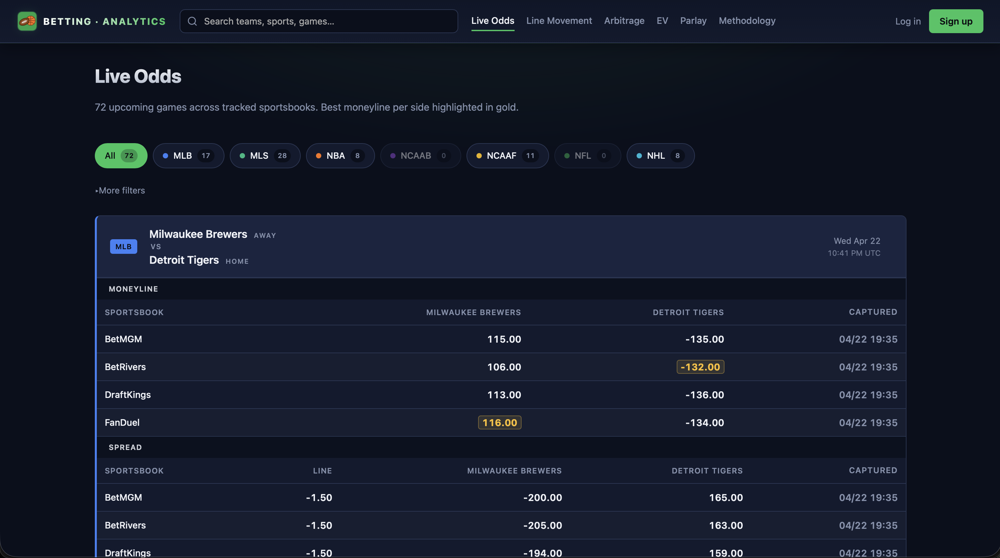
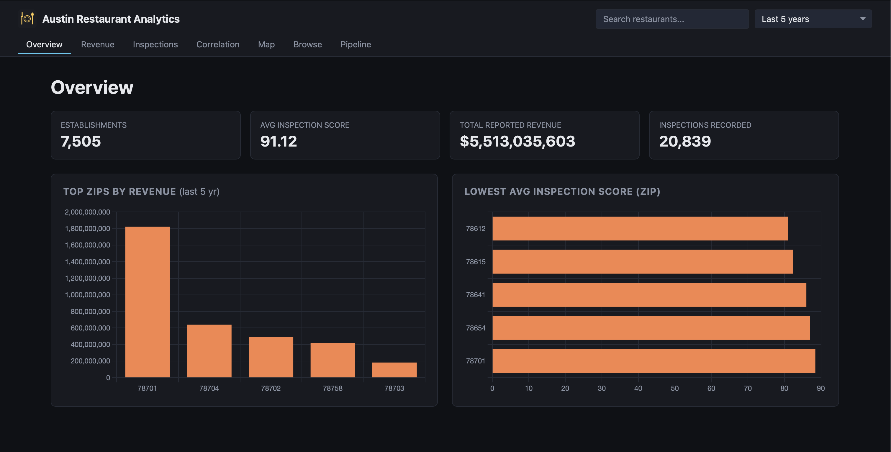

# Andrew Vick — Data Analyst & Full-Stack Builder

📧 andrew.vick@me.com &nbsp;|&nbsp; 📍 Houston, TX &nbsp;|&nbsp; [LinkedIn](https://www.linkedin.com/in/andrew-m-vick) &nbsp;|&nbsp; [Resume](https://github.com/andrew-m-vick/portfolio/blob/main/resume.pdf) &nbsp;|&nbsp; [CV](https://github.com/andrew-m-vick/portfolio/blob/main/cv.pdf)

---

## About Me

Hi, I'm Andrew — a data analyst and full-stack builder based in Houston, TX. I work across the complete analytics and engineering stack: Python, Flask, PostgreSQL, Apache Airflow, Tableau, and machine learning — and I ship what I build. Every project in this portfolio is deployed to production on Railway and is a click away.

What I care about is the handoff between analysis and decision. I've architected medallion-style ETL warehouses (Bronze → Silver → Gold), served scikit-learn models via joblib, embedded JWT-authenticated Tableau dashboards, and built quantitative tooling — Monte Carlo simulation with GBM drift correction, Kelly / EV sizing, scenario-weighted stress testing. Before data, I ran my own business for a decade, so I approach every analytical question with a P&L lens.

Currently pursuing a BBA in Finance at the University of Houston-Downtown to further strengthen quantitative and financial analysis capabilities. I hold a certificate in Data Analytics & Visualization from Rice University.

**Targeting roles in:** full-stack / Flask web development · analytics / data engineering · finance & quantitative analysis

---

## Technical Skills

- **Languages:** Python, SQL, JavaScript, TypeScript, HTML, CSS, VBA
- **Frameworks & Libraries:** Flask (app factory + blueprints), SQLAlchemy, Flask-Login, Flask-Migrate (Alembic), Jinja, React 18, Next.js, Vite, React Router, Bootstrap, Pandas, NumPy, Scikit-Learn, PySpark, Chart.js, Leaflet.js, AG Grid, KaTeX
- **Databases:** PostgreSQL (Neon, pgAdmin), MySQL, SQLite, MongoDB
- **Data Engineering:** Apache Airflow, Medallion Architecture (Bronze / Silver / Gold), ETL pipelines, REST API integration, rapidfuzz fuzzy matching, Socrata APIs
- **Visualization:** Tableau (JWT embed), Power BI, Matplotlib, Plotly, Chart.js, Leaflet
- **ML / AI:** Scikit-Learn (regression, prediction), joblib model persistence, Monte Carlo simulation, Claude (Anthropic) and Groq LLM APIs
- **DevOps & Tools:** Git, GitHub Actions, Docker Compose, Railway, Gunicorn, SendGrid, pytest, PWAs (service workers + manifests), AWS, Databricks, Jupyter, VS Code

---

## Projects

### 🎬 [CINEDATA — Movie Box Office Analytics Platform](https://andrew-vick-movies.up.railway.app)
A cinephile's dashboard for tracking what's in theaters, what's streaming, and what's coming — with a focus on premium formats and the curation a repertory programmer would actually give. Built a full-stack movie analytics platform that aggregates data from TMDB, OMDb, and Watchmode APIs to surface box office trends, upcoming release pipeline, and streaming availability. Architected end-to-end with a Medallion Architecture data pipeline, interactive Chart.js dashboards, an in-browser forecast model, and a Groq-powered Llama 3.3 AI recommender that goes global, era-diverse, and beyond obvious picks. **IMAX deep-dive:** an auto-updated Now Playing feed (GitHub Actions scrapes Wikipedia weekly), a manually curated registry of films *actually filmed* in IMAX (15/70mm vs. laser digital, no DMR upconverts), and a Leaflet-powered premium IMAX theater finder with auto-routing to the nearest 70mm or laser venue. Installable as a PWA on iOS / Android / desktop.

**Tools:** Python, Flask, Scikit-Learn, TMDB API, OMDb API, Watchmode API, Groq (Llama 3.3), Chart.js, Leaflet.js, GitHub Actions, JavaScript, HTML, CSS, Railway, Gunicorn

---

### 📊 [Sports Betting Analytics Platform](https://web-production-daac0.up.railway.app)
Retail bettors lack a single place to see EV, Kelly sizing, arbitrage, and line movement across books. Built a full-stack betting analytics platform covering 7 US sports with live odds ingestion from The Odds API, quantitative tooling (expected value, Kelly sizing, Monte Carlo simulation, arbitrage detection), and a PostgreSQL-backed user system with bankroll tracking and bet history. Deployed as a PWA on Railway so it installs to a phone home screen.

**Tools:** Python, Flask, SQLAlchemy, Flask-Login, PostgreSQL (Neon), The Odds API, JavaScript, Chart.js, Service Workers, Railway

---

### 💹 [Finance Quant Toolkit](https://web-production-a0dcb.up.railway.app)
Retirement calculators either ignore volatility entirely or bury it behind a black-box slider. Built a finance tooling suite with two first-class calculators: a scenario-weighted stress test (bull / base / bear with custom probabilities) and a Monte Carlo retirement simulator running geometric Brownian motion with proper drift correction (m = ln(1+μ) − σ²/2). Outputs include depletion-age percentiles, success probability, and KaTeX-rendered math so the assumptions are auditable.

**Tools:** Python, Flask, NumPy, SciPy, Chart.js, KaTeX, JavaScript, HTML, CSS, Railway

---

### 🍽️ [Austin Restaurant Industry Analytics](https://texas-restaurants-production.up.railway.app)
Three public Texas datasets that nobody had joined: state mixed beverage gross receipts, City of Austin food inspection scores, and TABC license records. Built an end-to-end Medallion Architecture warehouse (Bronze → Silver → Gold) in PostgreSQL, orchestrated by Airflow (with a GitHub Actions mirror for hosted refresh), that reconciles 8,630 establishments — 1,177 fuzzy-matched across all three sources via `rapidfuzz` token-set scoring with ZIP-code blocking, greedy assignment, and persisted match provenance. **Serving twist:** every dashboard query is materialized to static JSON at build time and committed alongside the code, so production runs Flask + static files with **no database at runtime** ($0 DB hosting, sub-millisecond responses, full PWA offline support). Two independent frontends consume the same JSON contract — a vanilla JS dashboard and a React 18 / TypeScript / Vite SPA. **Headline finding:** Pearson *r* = 0.053 between inspection score and bar revenue — a clean null result that contradicts the conventional wisdom.

**Tools:** Python, Flask, PostgreSQL 16, Apache Airflow, GitHub Actions, rapidfuzz, pgeocode, Socrata APIs, React 18, TypeScript, Vite, Leaflet.js, Chart.js, Docker Compose, Railway

---

## Selected Experience

### Indigena Capital — Data Analyst / Developer
Building data and web platforms for Indigenous community partners. Current work with the **Blood Tribe / Kainai Nation** is **Kainai Forage** — a password-protected, role-gated full-stack platform covering 2019–2025 Timothy and S-Timothy yield data across BTAP, SW Expansion, and Mataki sites (659 pivot-year records, 65 columns). Shipped a 22-feature scikit-learn RandomForest yield-prediction model with Normal / Dry / Wet weather scenarios, ±1σ confidence ranges, top-driver explanations, peer percentiles, and Excel batch-prediction. Frontend includes 28 dashboard sections, an AG Grid data table with checkbox-filter dropdowns, a Leaflet pivot map, per-farmer dashboards, and full admin tooling for upload / retrain / forecast refresh. Auxiliary work: a Tableau Connected App JWT embed layer (PyJWT), a SendGrid-backed notification system, and a **hey·hay** PWA mockup (Next.js 15 target stack) for full-truckload hay ordering with distance-based freight math. Installable on iPhone / Android home screens as a PWA, with Open-Meteo-driven 14-day forecasts and a weekly Render cron for retraining.

---

*Each project above links to a live production deployment. Source code for all Railway-deployed projects is available on [my GitHub](https://github.com/andrew-m-vick).*
